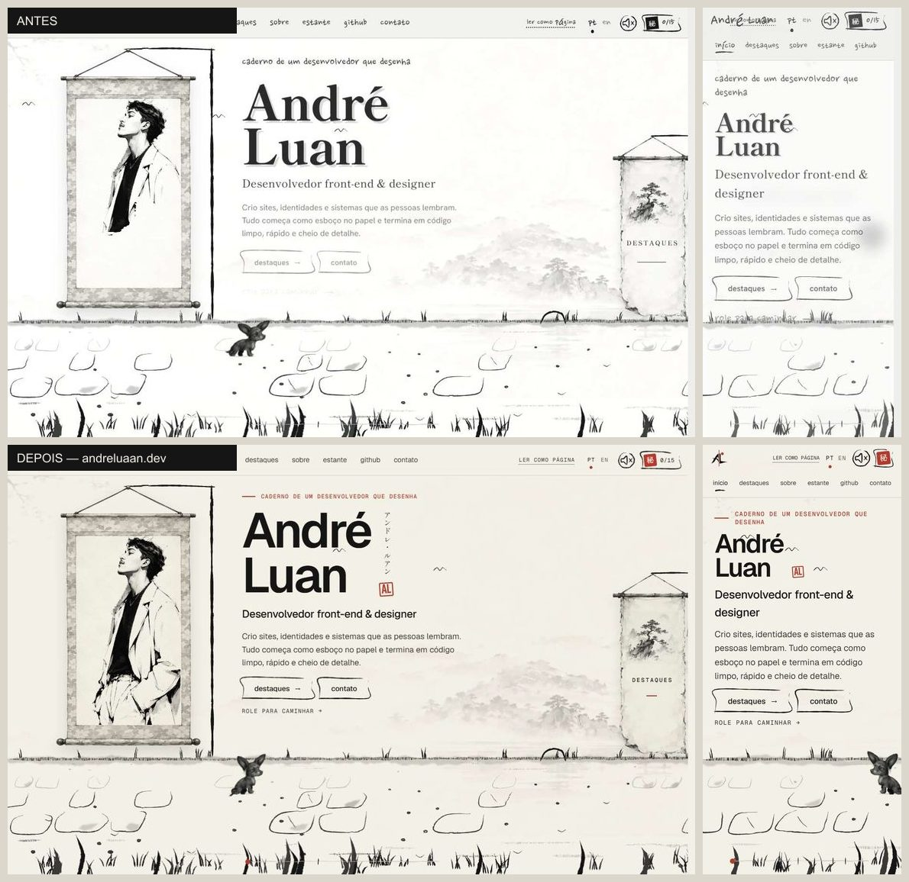

# Identidade andreluaan.dev no portfólio

Registro da troca de identidade feita em 24/11/2026. O portfólio deixou a identidade "caderno em nanquim" (cinza frio, Shippori Mincho, letra à mão) e passou a usar a marca pessoal **andreluaan.dev**. O mundo de papel continua igual: as estações, a Mel, o Borrão, os segredos, o livro e o caderno de recados. O que mudou foi a identidade aplicada sobre ele.

**Fonte de verdade da marca:** `C:\PROJETOS DE PROGRAMAÇÃO\Andreluaan.dev\DOCUMENTACAO-TECNICA.md` (manual v2.0). Se a marca mudar lá, este arquivo diz onde cada peça mora aqui.

---

## 1. O que veio da marca

| Peça da marca | Onde está no site | Arquivo |
|---|---|---|
| Cores: papel `#F3F0E8`, sumi `#151515`, cinza `#7A766E`, shu `#B5392C` | Tokens em `:root` | `src/styles/global.css` |
| Geist + Geist Mono | Todo o texto; o mono é a "voz de código" (legendas, notas, números) | `global.css` (`--font-sans`, `--font-mono`) |
| Regra do ponto redondo (manual p. 05) | Todo "." vem da Zen Maru Gothic, no peso equivalente | `src/styles/brand-fonts.css`, `public/fonts/ponto-*.woff2` |
| Katakana アンドレ・ルアン em Shippori Mincho | Ao lado do nome, no início (some no mapa estreito) | `public/fonts/kana.woff2` |
| AL reduzido (a partir de 32 px) | Barra do topo, favicon 32/48, ícone da tela inicial | `public/brand/al.svg` |
| Símbolo com a tag `< / >` (v2.0, era o "AL principal com circuito") | Capa sumi do caderno de projetos (versão negativa). Cópia de `Andreluaan.dev/marca/andreluaan-simbolo(-negativo).svg`, 576 × 495 | `public/brand/al-completo(-escuro).svg` |
| Wordmark `andreluaan.dev` com o cursor shu | Barra do topo (só a partir de 1181 px), intro e fim do caminho | `.wordmark` em `src/styles/brand.css` |
| Hanko | Assina o nome no início e a capa do caderno | `public/brand/hanko.svg` |
| Marca de memória | Loader da intro, última página do caderno, favicon da aba (16 px) | `src/lib/memory-mark.ts` |
| Movimento da marca de memória (p. 22) | Círculo 0–400 ms, fio até 600 ms, corte até 750 ms, curva (0.2, 0.7, 0.2, 1) | `.memory-mark.is-playing` em `brand.css` |
| Página sumi abrindo seção (p. 00) | Capa do caderno de projetos: tinta clara, shu `#C8503E` | `.book-cover` em `src/styles/book.css` |

A marca de memória e o selo só existiam no Figma. A marca de memória foi **construída em código a partir das medidas do manual** (D = diâmetro; traço 0,08 D; corte 0,07 D; metade direita deslocada 0,05 D; fio passando 0,18 D além do círculo). Para os ícones, o fio fica mais grosso, para o corte aparecer em 16 px.

## 2. Onde o shu aparece (e só aí)

O manual limita o shu a 2% da área: o fio, o ponto, o selo e o hanko. No site:

- **Fio (corte):** o traço do eyebrow do início, o cursor sob o wordmark e sob o nome de cada placa, o fio da marca de memória e o corte do ensō no fim do caminho.
- **Ponto:** a gota que marca o idioma atual, o pingo da pincelada do menu, a ponta da barra de progresso da caminhada e o nó "você está aqui" do diário de missões.
- **Selo/hanko:** o botão 秘 dos segredos, os carimbos encontrados no passaporte, no aviso de segredo e na ficha, o hanko ao lado do nome e o da capa do caderno.
- **Texto:** só o eyebrow do início ("CADERNO DE UM DESENVOLVEDOR QUE DESENHA"), como na página 16 do manual. Contraste 5,1:1.

## 3. Decisões tomadas sem o André (conferir)

Ele pediu para não ser consultado durante o trabalho. Estas escolhas são reversíveis e merecem uma olhada:

1. **A letra à mão (Nanum Pen Script) saiu.** O papel dela, a classe `.hand`, virou a voz mono da marca: Geist Mono, caixa alta e espaçamento de 10%. A classe manteve o nome para não mexer em 30 pontos do código. O caderno de recados agora escreve como um terminal, e o prompt "visitante ~ ✒" já tinha essa cara.
2. **A pintura do rolo e as peças (casa, placa, quadro, moldura…) foram "impressas" no papel da marca.** Não houve repintura: `prototipo/rolo/adapt.py` e `prototipo/pecas/recortar.py` multiplicam a imagem pela cor do papel, e o branco vira `#F3F0E8`. É feito no build, então não custa nada no navegador. Para voltar ao branco, é só tirar o `PAPER` dos dois scripts e rodá-los de novo.
3. **As pinceladas gravadas trocaram de tom.** Os cinzas frios viraram os neutros quentes da marca (`scripts/ink-bake/page.ts`, `TONES`). A aguada usa `#8E8A82`, o cinza das páginas escuras do manual, para manter o peso que tinha.
4. **O cinza de texto é um tom mais escuro que o da marca.** O `#7A766E` sobre o papel dá 3,97:1, abaixo do mínimo AA (4,5:1) nos tamanhos de legenda. O token `--wash` usa `#6B675F` (4,9:1), e as pinceladas continuam no tom da marca.
5. **O ensō do fim do caminho vira a marca de memória.** Ele é pincelado inteiro, o fio shu desce, corta, e a metade direita escorrega. A última página do caderno fecha com a marca de memória vetorial.
6. **Título da aba:** "André Luan · andreluaan.dev — tinta, corte e código" (EN: "ink, cut and code").
7. **E-mail de contato mantido** (`andre.luanbq@gmail.com`). A documentação da marca pede para não usar o e-mail pessoal nas peças da marca, mas trocar o contato do site é decisão dele. O endereço `contato@andreluaan.dev` ainda não existe.
8. **Sem mascote na marca, com mascotes no site.** A marca exclui Borrão e Dengon. O portfólio mantém Borrão e Mel, porque são recursos do site e não da identidade.

## 4. Correções feitas no caminho (defeitos que já existiam)

- **Barra do topo no celular:** a assinatura sobrepunha "ler como página" e o menu cortava "contato". Agora há três faixas. Até 800 px, a barra tem duas linhas e o menu divide a largura. De 801 a 1180 px, fica uma linha só com o símbolo. Acima disso, entram símbolo e wordmark. Abaixo de 430 px, o botão de segredos mostra só o selo, e a contagem aparece dentro do passaporte. Conferido em 320, 360, 375, 390, 768, 800, 820, 1024, 1180, 1280 e 1440 px, sem rolagem lateral.
- **Início em telas baixas (360×640, 375×667):** a barra cobria a primeira linha. O texto desce pela diferença entre a altura da barra em pixels e a altura que o mapa planejou (`translate` calculado com `--zoom`).
- **Ateliê no celular:** o quadro ocupa 92% da tela e a câmera parava 12% antes dele, cortando o segundo card. Estações que cabem na tela, mas não com a margem, agora ficam centralizadas (`offsetFor` em `src/world/index.ts`). O varal, mais largo que a tela, continua sendo percorrido desde o começo.
- **Modo leitura:** as hastes das placas, que viraram imagens na gravação do build, não eram escondidas e cruzavam o texto com uma linha preta.
- **Balões da Mel e do Borrão:** frases longas, ou ditas perto da borda, saíam da tela, e a fonte mono, mais larga, piorava isso. Agora quebram em até 230 px e são empurrados para dentro da tela enquanto aparecem (`keepOnScreen` em `src/lib/mascot.ts`). Medido em 360, 390, 820 e 1440 px: nenhum passa da borda.
- **Caderno de recados no celular:** o campo de texto partia de 20 caracteres, mais largos na fonte mono, e a janela rolava para o lado. Agora o campo cresce a partir de zero.
- **Foco do teclado no menu:** o menu, que rola de lado, cortava o contorno de foco. O contorno agora fica por dentro do item.
- **Favicon:** ainda era o padrão do Astro.

## 5. Desempenho

Medido com `npm run perf` (CPU 4×, Fast 4G, mediana de 3). O script ganhou `--mobile` (390×844, 3×, toque).

| Rodada | LCP | Bloqueio (TBT) | CLS | p95 do quadro | Quadros > 33 ms | Fontes | CSS |
|---|---|---|---|---|---|---|---|
| Antes, desktop (`10-antes-da-marca`) | 1,19 s | 279 ms | 0,006 | 16,8 ms | 7 | 150 KB | 23 KB |
| **Depois, desktop** (`11-marca-andreluaan`) | **1,12 s** | **229 ms** | 0,006 | 16,8 ms | **5** | **62 KB** | **13 KB** |
| Antes, celular (`10-antes-da-marca-mobile`) | 1,12 s | 230 ms | 0,011 | 16,8 ms | 5 | 150 KB | 23 KB |
| **Depois, celular** (`11-marca-andreluaan-mobile`) | **1,10 s** | **214 ms** | **0,008** | 16,8 ms | 5 | **62 KB** | **13 KB** |

Nada piorou, e o desktop ficou dentro da referência anterior do projeto (1,15 s / 0,24 s / 0,006 / 16,8 ms). O ganho vem das fontes: a Geist variável, com a Geist Mono, pesa menos que Shippori, Hanken e Nanum juntas, e as duas fontes emprestadas foram recortadas aos glifos usados (o ponto tem cerca de 450 B por peso e o kana 7,4 KB). Papel e tons novos são gravados no build, sem mistura de cores nem filtros no navegador. Os balões que se mantêm na tela só rodam um laço por quadro enquanto estão abertos, e só leem posição (transformações não refazem o layout).

Sem erros no console em nenhuma das medições nem nas capturas de tela.

## 6. Como regenerar cada peça

| Mudou… | Rode | Commite |
|---|---|---|
| Um glifo de segredo ou o katakana | `python scripts/fonts/subset.py` (precisa de `pip install fonttools brotli`) | `public/fonts/`, `src/styles/brand-fonts.css` |
| A marca de memória ou o AL reduzido | `node scripts/brand/icons.mjs` | `public/favicon.*`, `public/apple-touch-icon.png` |
| O papel da marca | `PAPER` em `prototipo/rolo/adapt.py` e `prototipo/pecas/recortar.py`, rode os dois; `TONES` em `scripts/ink-bake/page.ts` e `npm run ink` | `public/images/`, `public/ink/`, `src/data/` |
| Os SVGs da marca | Copiar de `Andreluaan.dev/` para `public/brand/`; a versão escura é a mesma com `#151515→#ECE8DF`, `#B5392C→#C8503E`, `#A9A49B→#4A4743` | `public/brand/` |

## 7. Sugestões para a próxima rodada

1. **Imagem de compartilhamento (og:image)** com o logo oficial sobre o papel. Precisa do domínio definido em `astro.config.mjs` (`site`), porque o link da imagem tem que ser absoluto.
2. **Modo escuro "papel sumi"**, com os tons escuros que o manual já define (tinta `#ECE8DF`, shu `#C8503E`, linhas `#34322F`). A capa do caderno já usa esse sistema de tokens.
3. **Selo circular** (o círculo da marca de memória em shu com o AL dentro) como recompensa ao achar os 15 segredos, no lugar do 秘.
4. **Circuito da marca** aparecendo bem fraco atrás do ateliê do GitHub: é a parte "tecnologia" do símbolo e combina com o mural de repositórios.
5. **E-mail `contato@andreluaan.dev`**, para o site e o cartão usarem o mesmo endereço.
